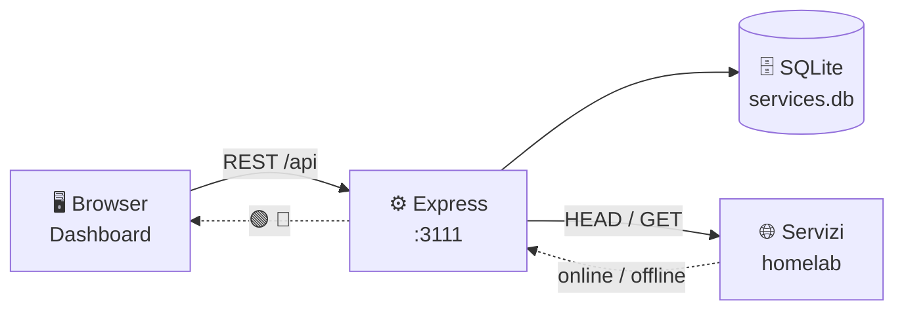

<div align="center">


<a href="https://github.com/GabriPy/process.ghibiri.it">
  
</a>

<br />


<br /><br />

**Tutti i tuoi servizi self-hosted in un'unica dashboard.**<br />
Card con pallino di stato live, categorie colorate e gestione completa da interfaccia.

</div>

---

## ✨ Anteprima

<p align="center">
  
</p>

<p align="center"><sub>Mockup illustrativo dell'interfaccia in tema scuro.</sub></p>

## 🚀 Caratteristiche

| | Funzionalità | Descrizione |
|:--|:--|:--|
| 🟢 | **Stato live** | Un pallino su ogni card: verde se il servizio risponde, rosso se è irraggiungibile. |
| 🗂️ | **Categorie** | Pagina dedicata per creare, rinominare ed eliminare categorie, ognuna con il suo colore. |
| 🎨 | **Sezioni colorate** | Le card sono raggruppate in sezioni per categoria, con bordo e badge nel colore scelto. |
| 🔤 | **Ordinamento A-Z** | Un toggle annulla il raggruppamento e ordina tutti i servizi alfabeticamente. |
| 🔍 | **Ricerca istantanea** | Filtra per nome o categoria mentre digiti. |
| 🧩 | **Dropdown categoria** | Nel form del servizio scegli la categoria da un menu: una sola per servizio. |
| 🖼️ | **Logo automatici** | Compatibile con [dashboard-icons](https://github.com/walkxcode/dashboard-icons), con fallback locale. |
| 🐳 | **Docker-ready** | Un `docker compose up` e sei online, con database persistente su volume. |

## 🧱 Stack

<div align="center">

| Layer | Tecnologie |
|:--|:--|
| **Backend** | Node.js 20 · Express 4 · SQLite (`sqlite3`) |
| **Frontend** | HTML singolo · Tailwind CSS (CDN) · Font Awesome 6 · JavaScript vanilla |
| **Infra** | Docker · Docker Compose · Alpine Linux |

</div>

## 🗺️ Come funziona



Il controllo di raggiungibilità avviene **lato server** (endpoint `/api/check`): così si evitano i blocchi CORS del browser e funzionano anche servizi senza header CORS.

## 🐳 Avvio rapido

```bash
git clone https://github.com/GabriPy/process.ghibiri.it.git
cd process.ghibiri.it
docker compose up -d --build
```

Apri **http://localhost:3111** 🎉

Il database viene salvato in `./data/services.db` tramite volume, quindi sopravvive ai riavvii.

<details>
<summary><b>💻 Avvio in locale (senza Docker)</b></summary>

<br />

```bash
npm ci        # oppure: npm install
npm start
```

Richiede Node.js 20+. La cartella `data/` e il DB vengono creati automaticamente al primo avvio.

</details>

## 🔌 API

| Metodo | Endpoint | Descrizione |
|:--|:--|:--|
| `GET` | `/api/services` | Elenco di tutti i servizi |
| `POST` | `/api/services` | Crea un servizio |
| `PUT` | `/api/services/:id` | Modifica un servizio |
| `DELETE` | `/api/services/:id` | Elimina un servizio |
| `GET` | `/api/categories` | Elenco categorie con conteggio servizi |
| `POST` | `/api/categories` | Crea una categoria |
| `PUT` | `/api/categories/:id` | Rinomina / ricolora (aggiorna i servizi collegati) |
| `DELETE` | `/api/categories/:id` | Elimina una categoria (solo se non in uso) |
| `GET` | `/api/check?url=` | Verifica se un servizio è raggiungibile |

<details>
<summary><b>Esempio: creare un servizio</b></summary>

<br />

```bash
curl -X POST http://localhost:3111/api/services \
  -H "Content-Type: application/json" \
  -d '{
    "name": "Portainer",
    "url": "http://localhost:9000",
    "logo": "https://cdn.jsdelivr.net/gh/walkxcode/dashboard-icons/png/portainer.png",
    "category": "Gestione"
  }'
```

</details>

## 📁 Struttura del progetto

```
process.ghibiri.it/
├── server.js              # API Express + SQLite (servizi, categorie, check)
├── public/
│   ├── index.html         # Dashboard (viste, sezioni, modali, stato live)
│   └── default-icon.svg   # Icona di fallback
├── data/                  # Volume Docker con services.db (ignorato da git)
├── Dockerfile
├── docker-compose.yml
└── package.json
```

## 🎨 Icone

I logo dei servizi accettano qualsiasi URL. La lista consigliata è [walkxcode/dashboard-icons](https://github.com/walkxcode/dashboard-icons) — sfogliabile su [dashboardicons.com](https://dashboardicons.com/):

```text
https://cdn.jsdelivr.net/gh/walkxcode/dashboard-icons/svg/<nome>.svg
https://cdn.jsdelivr.net/gh/walkxcode/dashboard-icons/png/<nome>.png
```

Se il logo manca o non carica, la card usa automaticamente `public/default-icon.svg`.

---

<div align="center">


<sub>Fatto con ☕ per il mio homelab · <a href="https://github.com/GabriPy">@GabriPy</a></sub>

</div>
