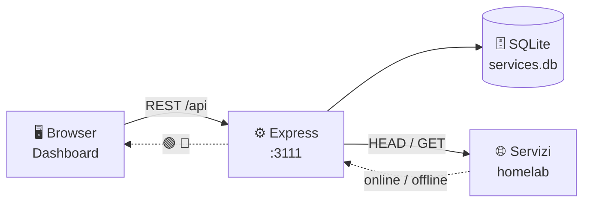

<div align="center">


<a href="https://github.com/GabriPy/process.ghibiri.it">
  
</a>

<br />


<br /><br />

**Tutti i tuoi servizi self-hosted in un'unica dashboard.**<br />
Card con pallino di stato live, categorie colorate, domini riutilizzabili e accesso protetto da PIN.

</div>

---

## ✨ Anteprima

<p align="center">
  
</p>

<p align="center"><sub><b>Dashboard</b> · card raggruppate per categoria, pallino di stato live e riordino con drag &amp; drop.</sub></p>

<table align="center">
  <tr>
    <td align="center" width="33%">
      
      <sub><b>🔐 Login con PIN</b><br/>Sblocco a 4 cifre protetto da cookie firmato.</sub>
    </td>
    <td align="center" width="33%">
      
      <sub><b>🗂️ Categorie e domini</b><br/>Colori, conteggi e domini riutilizzabili.</sub>
    </td>
    <td align="center" width="33%">
      
      <sub><b>🌐 Nuovo servizio</b><br/>Protocollo, nome e dominio con anteprima URL.</sub>
    </td>
  </tr>
</table>

<p align="center"><sub>Mockup illustrativi (animati) dell'interfaccia in tema scuro.</sub></p>

## 🚀 Caratteristiche

| | Funzionalità | Descrizione |
|:--|:--|:--|
| 🟢 | **Stato live** | Un pallino su ogni card: verde se il servizio risponde, rosso se è irraggiungibile. |
| ⏱️ | **Aggiornamento automatico** | Gli stati si ricontrollano ogni 60 secondi con **una sola richiesta** (`/api/status`), in pausa quando la tab non è visibile. |
| 🔐 | **Login con PIN** | Accesso protetto da un PIN a 4 cifre, configurabile via variabile d'ambiente. |
| 🗂️ | **Categorie e domini** | Pagina dedicata per gestire le categorie (nome + colore) e i domini usati negli URL. Le categorie sono condivise tra servizi e collegamenti. |
| 🔗 | **Collegamenti** | Vista per i siti esterni: categorie con sezioni comprimibili, ricerca, favicon automatico, colore per card e copia dell'URL. |
| 🎨 | **Sezioni colorate e comprimibili** | Le card sono raggruppate per categoria; l'intestazione di ogni sezione la comprime e la espande (stato ricordato). |
| 🖱️ | **Drag & drop** | Trascina le card per riordinarle in ogni sezione: l'ordine viene salvato nel database. |
| 🌐 | **URL componibili** | Nel form scegli protocollo (https di default), nome, sottodominio e dominio da una tendina. |
| 🔤 | **Ordinamento A-Z** | Un toggle annulla il raggruppamento e ordina tutti i servizi alfabeticamente. |
| 🔍 | **Ricerca istantanea** | Filtra per nome o categoria mentre digiti, con contatore dei risultati. |
| 🧩 | **Dropdown categoria** | Nel form del servizio scegli la categoria da un menu: una sola per servizio. Vale anche per i collegamenti. |
| 🖼️ | **Logo automatici** | Compatibile con [dashboard-icons](https://github.com/walkxcode/dashboard-icons), con fallback locale. |
| 🔔 | **Notifiche toast** | Conferme ed errori appaiono come toast non bloccanti, con `aria-live` per gli screen reader. |
| 💾 | **Backup JSON** | Esporta e ripristina servizi, categorie, domini e collegamenti dalla vista *Categorie e domini*. |
| 📱 | **Installabile come app** | Web App Manifest e icone: si aggiunge alla home di telefono e desktop come app autonoma. |
| 🐳 | **Docker-ready** | Un `docker compose up` e sei online, con database persistente su volume. |

### ⌨️ Scorciatoie

| Tasto | Azione |
|:--|:--|
| `Ctrl` / `⌘` + `K` | Porta il focus sulla ricerca |
| `/` | Porta il focus sulla ricerca (fuori dai campi di testo) |
| `Esc` | Chiude il modale aperto |

L'ordinamento scelto e le sezioni compresse vengono salvati in `localStorage`.

## 🧱 Stack

<div align="center">

| Layer | Tecnologie |
|:--|:--|
| **Backend** | Node.js 20 · Express 4 · SQLite (`sqlite3`) |
| **Frontend** | HTML singolo · Tailwind CSS (CDN) · Font Awesome 6 · JavaScript vanilla |
| **Infra** | Docker · Docker Compose · Alpine Linux |

</div>

## 🗺️ Come funziona



Il controllo di raggiungibilità avviene **lato server** (endpoint `/api/status`): così si evitano i blocchi CORS del browser e funzionano anche servizi senza header CORS. La dashboard invia tutti gli URL in un'unica richiesta, che il server esegue con un massimo di 6 controlli in parallelo e memorizza per 30 secondi.

## 🐳 Avvio rapido

```bash
git clone https://github.com/GabriPy/process.ghibiri.it.git
cd process.ghibiri.it
AUTH_PIN=4821 docker compose up -d --build
```

Apri **http://localhost:3111** e inserisci il PIN 🎉

Il database viene salvato in `./data/services.db` tramite volume, quindi sopravvive ai riavvii.

## 🔐 Login con PIN

L'accesso è protetto da un **PIN a 4 cifre** letto dalla variabile d'ambiente `AUTH_PIN`:

```yaml
# docker-compose.yml
environment:
  - AUTH_PIN=${AUTH_PIN:-1234}
```

| Comportamento | Dettaglio |
|:--|:--|
| **Sessione** | Token firmato HMAC-SHA256 con scadenza 30 giorni, salvato in un cookie `httpOnly` + `SameSite=Lax`. |
| **Persistenza** | Nessuno stato lato server: la sessione resta valida anche dopo il riavvio del container. |
| **Protezione** | Tutte le API rispondono `401` senza un cookie valido; l'interfaccia mostra la schermata di sblocco. |
| **PIN disattivato** | Se `AUTH_PIN` non è impostata, l'autenticazione viene ignorata (comodo in sviluppo locale). |

Per cambiare il PIN basta rieseguire il compose con un nuovo valore:

```bash
AUTH_PIN=9173 docker compose up -d
```

> Il PIN di default nel compose è `1234`: cambialo prima di esporre la dashboard.

<details>
<summary><b>💻 Avvio in locale (senza Docker)</b></summary>

<br />

```bash
npm ci        # oppure: npm install
npm start
```

Richiede Node.js 20+. La cartella `data/` e il DB vengono creati automaticamente al primo avvio.

</details>

## 🔌 API

| Metodo | Endpoint | Descrizione |
|:--|:--|:--|
| `GET` | `/api/auth` | Stato dell'autenticazione (richiesta / attiva) |
| `POST` | `/api/login` | Login con PIN, imposta il cookie di sessione |
| `POST` | `/api/logout` | Chiude la sessione |
| `GET` | `/api/services` | Elenco servizi, ordinati per posizione |
| `POST` | `/api/services` | Crea un servizio |
| `PUT` | `/api/services/:id` | Modifica un servizio |
| `PUT` | `/api/services/order` | Salva l'ordine delle card (`{ "order": [id, ...] }`) |
| `DELETE` | `/api/services/:id` | Elimina un servizio |
| `GET` | `/api/categories` | Elenco categorie con conteggio servizi |
| `POST` | `/api/categories` | Crea una categoria |
| `PUT` | `/api/categories/:id` | Rinomina / ricolora (aggiorna i servizi collegati) |
| `DELETE` | `/api/categories/:id` | Elimina una categoria (solo se non in uso) |
| `GET` | `/api/domains` | Elenco dei domini |
| `POST` | `/api/domains` | Aggiunge un dominio |
| `PUT` | `/api/domains/:id` | Rinomina un dominio |
| `DELETE` | `/api/domains/:id` | Elimina un dominio |
| `GET` | `/api/links` | Elenco dei collegamenti esterni |
| `POST` | `/api/links` | Aggiunge un collegamento |
| `PUT` | `/api/links/:id` | Modifica un collegamento |
| `DELETE` | `/api/links/:id` | Elimina un collegamento |
| `GET` | `/api/check?url=` | Verifica un singolo servizio (mantenuto per compatibilità) |
| `POST` | `/api/status` | Verifica più servizi insieme (`{ "urls": [...] }`), con cache di 30 s |
| `GET` | `/api/backup` | Scarica un backup JSON completo (servizi, categorie, domini, collegamenti) |
| `POST` | `/api/restore?mode=replace\|merge` | Ripristina un backup: `replace` sostituisce tutto, `merge` aggiunge solo i mancanti |

Tutte le rotte `/api/*` (tranne `auth` e `login`) richiedono il cookie di sessione.

<details>
<summary><b>Esempio: creare un servizio</b></summary>

<br />

```bash
curl -X POST http://localhost:3111/api/services \
  -H "Content-Type: application/json" \
  -b "ghibiri_session=<cookie>" \
  -d '{
    "name": "Portainer",
    "url": "https://portainer.ghibiri.it",
    "logo": "https://cdn.jsdelivr.net/gh/walkxcode/dashboard-icons/png/portainer.png",
    "category": "Gestione"
  }'
```

L'interfaccia compone lo stesso URL partendo da protocollo + sottodominio + dominio, ma l'API accetta qualsiasi `url` completo.

</details>

## 💾 Backup e ripristino

Dalla vista **Categorie e domini** trovi il riquadro *Backup*: **Esporta** scarica un file `ghibiri-hub-backup-AAAA-MM-GG.json` con tutti i servizi, le categorie, i domini e i collegamenti; **Importa** rilegge quello stesso file.

```bash
# backup da riga di comando
curl -b "ghibiri_session=<cookie>" http://localhost:3111/api/backup > backup.json

# ripristino (sostituisce i dati attuali)
curl -X POST http://localhost:3111/api/restore?mode=replace \
  -H "Content-Type: application/json" \
  -b "ghibiri_session=<cookie>" \
  --data @backup.json
```

Il ripristino valida i dati (nome obbligatorio, URL `http`/`https`, colori nel formato `#rrggbb`) e gira in una **transazione**: se qualcosa fallisce non viene scritto nulla. In `replace` vengono svuotate solo le sezioni presenti nel file, quindi un backup vecchio (senza `links`) non cancella i collegamenti già salvati. In alternativa al JSON puoi sempre copiare `data/services.db`, che resta la fonte di verità.

## 📱 Installazione come app (PWA)

La dashboard include un [Web App Manifest](public/manifest.webmanifest) e le icone in `public/icons/`, quindi si installa come app autonoma (senza barra degli indirizzi):

| Piattaforma | Come |
|:--|:--|
| **Android / Chrome / Edge** | Menu ⋮ → *Installa app* (l'icona automatica in barra degli indirizzi può non comparire senza service worker) |
| **iOS / Safari** | *Condividi* → *Aggiungi a Home* |
| **Desktop** | Menu → *Installa* (Chrome/Edge) |

> L'installazione richiede un **contesto sicuro**: HTTPS (es. tunnel Cloudflare) o `localhost`. In HTTP semplice su IP privato il browser non la propone, ma la dashboard resta pienamente utilizzabile.
>
> Non c'è un service worker: l'app non funziona offline e ogni avvio carica la versione corrente, così non rischi pagine in cache dopo un aggiornamento. Dal 2023 Chrome non richiede più un `fetch` handler per installare dal menu, anche se il prompt automatico può non apparire ([fonte](https://developer.chrome.com/blog/update-install-criteria)).

## 📁 Struttura del progetto

```
process.ghibiri.it/
├── server.js              # API Express + SQLite (servizi, categorie, domini, auth PIN, stato, backup)
├── public/
│   ├── index.html         # Dashboard (viste, drag & drop, modali, login, stato live, backup)
│   ├── manifest.webmanifest # Manifest PWA (nome, icone, tema)
│   ├── icons/             # Icone PNG per installazione e iOS
│   └── default-icon.svg   # Icona di fallback
├── data/                  # Volume Docker con services.db (ignorato da git)
├── docs/
│   ├── preview.svg          # Anteprima dashboard (animata)
│   ├── preview-login.svg    # Anteprima login con PIN
│   ├── preview-categorie.svg # Anteprima categorie e domini
│   └── preview-form.svg     # Anteprima form nuovo servizio
├── Dockerfile
├── docker-compose.yml     # Porta 3111, volume dati, variabile AUTH_PIN
└── package.json
```

## 🎨 Icone

I logo dei servizi accettano qualsiasi URL. La lista consigliata è [walkxcode/dashboard-icons](https://github.com/walkxcode/dashboard-icons) — sfogliabile su [dashboardicons.com](https://dashboardicons.com/):

```text
https://cdn.jsdelivr.net/gh/walkxcode/dashboard-icons/svg/<nome>.svg
https://cdn.jsdelivr.net/gh/walkxcode/dashboard-icons/png/<nome>.png
```

Se il logo manca o non carica, la card usa automaticamente `public/default-icon.svg`.

---

<div align="center">


<sub>Fatto con ☕ per il mio homelab · <a href="https://github.com/GabriPy">@GabriPy</a></sub>

</div>
